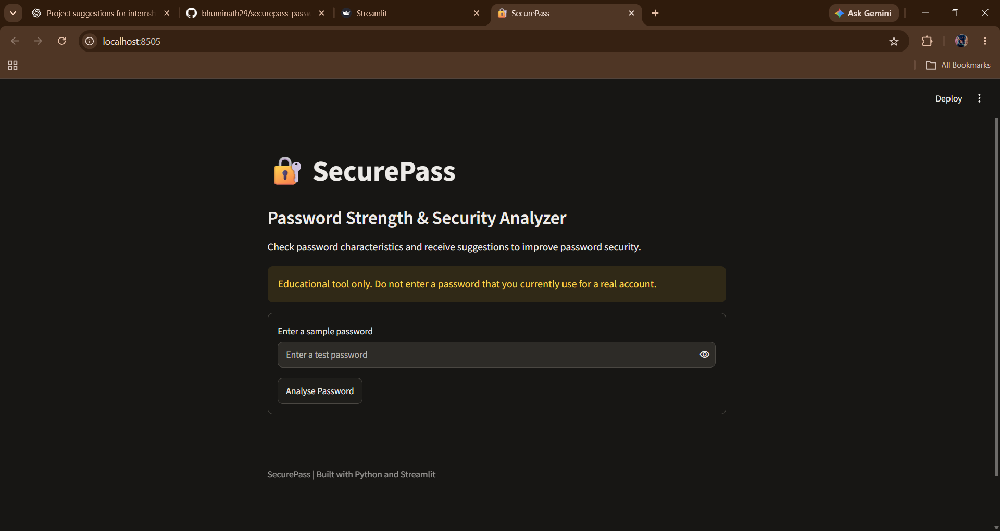

# 🔐 SecurePass – Password Strength & Security Analyzer

A beginner-friendly Python cybersecurity project that analyses password characteristics and provides suggestions to improve password security.

## 📌 About the Project

SecurePass is an educational password analysis application built using Python and Streamlit.

It evaluates password length, character diversity, common password patterns and repeated characters. It also calculates a simplified theoretical entropy estimate and provides improvement suggestions.


## ✨ Features

- Password length analysis
- Uppercase and lowercase character detection
- Number and special character detection
- Basic common-password matching
- Repeated-character detection
- Sequential-pattern detection
- Simplified password entropy estimation
- Password strength classification
- Security improvement suggestions

## 🛠️ Technologies Used

- Python
- Streamlit
- Regular Expressions
- Python unittest

## 📂 Project Structure

```text
SecurePass/
├── tests/
│   └── test_analyzer.py
├── app.py
├── analyzer.py
├── requirements.txt
├── .gitignore
└── README.md
```

## ⚙️ Installation and Setup

### 1. Clone the repository

```bash
git clone https://github.com/bhuminath29/securepass-password-analyzer.git
cd securepass-password-analyzer
```

### 2. Create a virtual environment

```bash
python -m venv .venv
```

### 3. Activate the environment

Windows PowerShell:

```powershell
.\.venv\Scripts\Activate.ps1
```

### 4. Install dependencies

```bash
python -m pip install -r requirements.txt
```

### 5. Run the application

```bash
python -m streamlit run app.py
```

The application will open in your browser.

## 🧪 Run Tests

```bash
python -m unittest discover -s tests -v
```

## 🔒 Privacy and Security

- The application does not intentionally save passwords to files or a database.
- It does not use an external password-checking API.
- It is designed for local educational use.
- Do not enter passwords used for real accounts.
- Do not deploy this version for real password entry.

## ⚠️ Limitations

This is an educational password assessment tool, not a production-grade password security system.

The common-password list is limited, the pattern checks are basic, and entropy is a simplified estimate. The application does not check data breaches, password reuse or actual attack resistance.

## 🎯 Learning Outcomes

Through this project, I practised:

- Python functions and conditional statements
- String manipulation and regular expressions
- Lists, sets and dictionaries
- Modular Python programming
- Basic cybersecurity concepts
- Unit testing
- Git and GitHub

## 👩‍💻 Project Type

Individual academic portfolio project

**Author:** Bhumi Nath

**GitHub:** https://github.com/bhuminath29

## Application Preview

